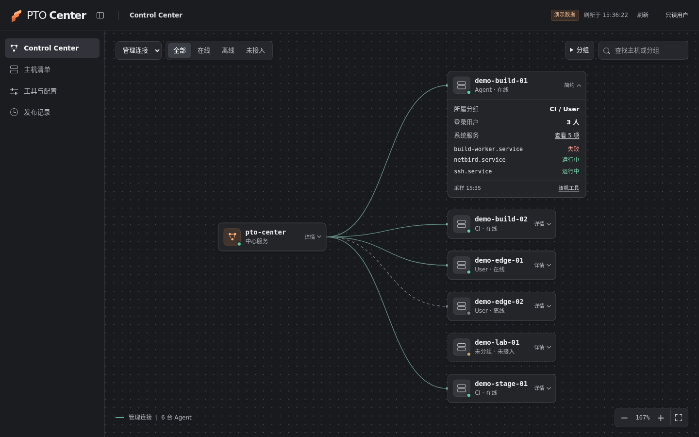

# pto-center

`pto-center` 通过 NetBird 集中管理 Linux 服务器上的工具。管理员在网页上选择机器、工具版本和配置。Center 下发任务，各机的 `pto-agent` 按需取回签名包、调用工具自己的适配器，并回报实际运行版本和配置生效情况。

首页 Control Center 以整页拓扑展示中心与各 Agent 的管理连接。可切换到「工具版本」对照已安装和运行版本，或在「分批发布」中查看第一批回执和第二批剩余主机。点击任一机器的「详情」可就地查看登录人数、systemd 服务状态和采样时间。每台机器可以单独切回简约模式。下图使用演示数据。



## 本地体验

在 Linux 上准备 Go 1.21 或更新版本、C 编译器、Python 3 和 Make，以普通用户运行本地双节点演示。

```sh
make demo
```

打开终端打印的管理地址，用 `admin` 和提示文件中的密码登录。演示提供两台 Agent 和两个可安装工具。在「安装工作流」可以创建「向服务器配置」模板，先装 `demo-info`，再装 `demo-service` 并下发最大并发数。[演练步骤](docs/running.md#新主机与安装工作流)

## 使用与接入

| 我想做什么 | 从哪里开始 |
|---|---|
| 部署中心，让一台新机加入 | [NetBird 端口、systemd 与首次注册](docs/running.md#netbird-部署) |
| 给一台或多台机器按顺序安装软件、应用配置 | [创建、编辑和重跑工作流](docs/running.md#新主机与安装工作流) |
| 让自己的工具进入可安装列表，增加配置字段或操作按钮 | [工具仓库接入指南](docs/tool-integration.md) |
| 为自己的服务发布新版本，决定哪些变更需要重新发包 | [受管服务发包准则](docs/tool-integration.md#受管服务发包准则) |
| 登记签名包并同步 GitHub 上的新版本 | [生成和注册工具包](docs/running.md#生成和注册工具包) |
| 查看 Agent 版本记录、分批自升级或回退 | [管理 Agent 自身的版本](docs/running.md#管理-agent-自身的版本) |

NetBird 试点已验证示例工具的顺序安装、离线排队、重复运行，以及两种 Linux 架构的 Agent 自升级。`pto-system-doctor` 可以管理两项配置，`npu-taskqueue` 可以查询队列和用量。两者都还需要实现 `install` 才能加入新机安装工作流。[首批工具](docs/running.md#首批工具) · [试点验证](docs/running.md#试点验证)

配置下发、任务恢复和分批发布均有逐机验收条件。[设计方案](docs/design.md) · [试点跟踪 issue](https://github.com/pypto-tools/pto-center/issues/1)
