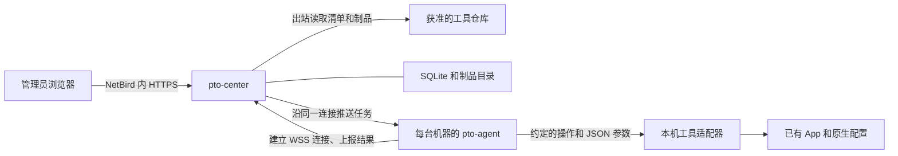

# pto-center v1 设计方案

管理员在网页上选一个 App，勾选一台、多台或全部已安装该 App 的服务器，查看逐机差异后发布。中心将任务推送给目标机器的 Agent。工具仓库维护自己的适配器，决定怎样读写配置、升级和确认生效。首版面向已接入 NetBird 的 Linux/systemd 服务器。

## 部署和访问



- **中心。** 部署在 NetBird 中心服务器上，该主机同时以 peer 身份加入网络。建议使用 Go、服务端渲染的 HTML 和 SQLite。数据库保存节点身份、工具清单版本、逐机盘点、配置修订、任务状态与审计记录。制品按摘要缓存到磁盘，受管机器可以通过 NetBird 取得发布所需的文件。
- **Agent。** 每台机器首次部署一个与其 CPU 架构匹配的程序，用一次性注册码取得独立节点凭据，由 systemd 拉起并主动连接中心。长连接用来承载中心指令及执行回报。Agent 根据自身身份只接收本机任务和对应制品。
- **访问入口。** 网页和管理 API 使用一个端口，节点连接和制品下载使用另一个端口。两者只绑定中心的 NetBird 地址，主机防火墙只允许 NetBird 接口入站，公网反向代理只承载原有服务。管理员设备组可以访问管理端口，服务器组可以访问节点端口。网页使用管理员身份登录，每个节点凭据可单独撤销。

NetBird 的放行策略会叠加。现网如有默认的 `All → All`，应先用明确规则覆盖现有业务，再收窄默认规则。部署验收包括从授权 peer、普通 peer 和网外分别测试两个端口。[NetBird 访问策略](https://docs.netbird.io/manage/access-control/manage-network-access)

## 工具注册与适配器

中心仓库维护版本化的 `tool.schema.json` 和适配器协议。工具仓库提供 `pto-tool.json`、适配器入口和可选的配置 Schema。管理员在网页登记仓库与清单路径，中心校验清单，解析到确定的源提交并记录清单和适配器摘要。每次发布固定所用版本与制品摘要，Agent 执行前校验。适配器可独立于工具分发，因而能探测接入中心以前的安装。

下面是为 `npu-taskqueue` 拟定的清单，展示一次接入需要声明哪些信息。

```json
{
  "apiVersion": "pto-center/v1",
  "id": "npu-taskqueue",
  "source": { "type": "git", "repository": "pypto-tools/npu-taskqueue" },
  "adapter": "adapters/pto-center",
  "capabilities": ["probe", "update", "read-config", "validate-config", "apply-config"],
  "configSchema": "config.schema.json",
  "configSchemaVersion": 1,
  "actions": [
    {
      "id": "custom.usage-report",
      "title": "查看 NPU 使用统计",
      "effect": "read",
      "supportsBatch": true,
      "inputSchema": {
        "type": "object",
        "properties": {
          "days": { "type": "integer", "minimum": 1, "maximum": 30, "default": 7, "title": "最近多少天" }
        },
        "required": ["days"],
        "additionalProperties": false
      }
    }
  ]
}
```

| 标准动作 | 协议约定 |
|---|---|
| `probe` | 必需的只读探测。报告已安装、未安装或无法判定，并返回能核实的安装版本、运行版本和本机支持的能力。 |
| `update` | 对已有安装应用指定版本，可以调用工具已有的更新脚本、空闲检查和更新锁。 |
| `read-config`、`validate-config`、`apply-config` | 支持中心配置管理的工具实现。分别读回托管字段、在本机校验候选变更、写入并报告生效情况。 |
| `install`、`activate`、`rollback` | 按工具能力提供。管理员可分别发起首次安装、激活已暂存的版本和回退到指定版本。 |

**自定义动作是协议的一部分。** `custom.*` 由各工具自行命名和实现，以工具 ID 与动作 ID 的组合标识。中心同步清单后，按标题生成按钮。有参数就按 `inputSchema` 生成表单，没有参数即可直接下发。只有声明支持批量的动作允许多选。示例中，选择两台主机并填入 3 天，网页就分别展示两台的统计结果。清单中的读写属性用于匹配中心授予的权限。执行前再次核对节点能力、参数和所需权限。

标准与自定义动作共用一个调用约定。Agent 调用经过校验的适配器入口，通过标准输入传递含任务 ID、动作 ID 和结构化参数的 JSON 请求。适配器可以复用 Shell、Python 或已有 CLI，通过标准输出逐行返回 JSON 进度事件及一个最终结果。结果包含状态、摘要，以及可选的结构化数据或错误原因。页面按数据渲染结果文本，日志与结果均须脱敏。工具仓库增加声明和同名实现即可扩展按钮，现有 Agent 和中心继续使用同一版协议。

中心根据已登记的来源和动作授权决定谁能发布，Agent 从已固定摘要的适配器中解析入口。只读探测和查询以受限身份运行，需要修改系统的步骤只授予对应工具所需的权限。动作参数始终作为数据传递。

## 配置如何下发

工具的 `config.schema.json` 定义允许中心管理的字段、类型、取值范围和说明。中心据此生成表单并校验输入。适配器将托管字段映射到工具已有的配置文件。下面的 Schema 示例只接管一个字段。

```json
{
  "type": "object",
  "properties": {
    "MAX_CONCURRENT": { "type": "integer", "minimum": 1, "title": "最大并发任务数" }
  },
  "required": ["MAX_CONCURRENT"],
  "additionalProperties": false
}
```

1. **选 App 和机器。** 管理员单选、多选或全选当前筛选结果。机器组用于筛选和一键全选，发布时冻结具体机器名单。首次接管和点击「刷新状态」都只读取现有配置。
2. **选字段并预览。** 当两台机器原值分别为 4 和 6，页面显示「多个值」。勾选「最大并发任务数」并填入 8 后，两行预览分别显示 `4 → 8` 和 `6 → 8`。本次写入限于所选字段，每台机器自己的设备列表等其他配置继续由原有设置管理。
3. **发布逐机任务。** 中心按「节点 × 工具」记录配置修订、Schema 版本、所选字段及预览时的基线值。Agent 读回这些字段，将变更与本机现状合并成候选配置，再校验完整候选值。旧版工具无法理解此 Schema 时报告版本不兼容。预览后同一字段被人工改动时报告冲突并展示差异。如果已等于目标值，则检查是否还需激活。
4. **写入与确认。** 适配器负责原生文件的安全替换、权限和生效方式。页面分别记录期望修订、已写入修订和可验证的生效修订。需要维护窗口的服务显示「已写入，待生效」。应用无法提供运行证据时，页面显示「生效状态未知」。凭据留在本机，中心仅管理引用。

例如，对于上面的两台机器，下发给其中一台的任务业务字段如下。另一台的基线值是 6，有独立的任务 ID。

```json
{
  "taskId": "example-config-18-a",
  "tool": "npu-taskqueue",
  "action": "apply-config",
  "configSchemaVersion": 1,
  "configRevision": 18,
  "expected": { "MAX_CONCURRENT": 4 },
  "values": { "MAX_CONCURRENT": 8 }
}
```

## 版本发布、故障恢复与迁移

中心发现候选版本后由管理员选择是否发布。目标可以是精确的 Git 提交，也可以是选定的 Release 制品与摘要。中心缓存与目标机器架构匹配的制品。管理员可以先发一台，查看健康和生效结果后再继续下一批。

| 情况 | Agent 与页面的行为 |
|---|---|
| 更新前复查 | Agent 再次执行 `probe`。未安装的实例跳过更新，无法识别的实例报告原因，明确的新装任务调用 `install`。已经安装目标版本的实例核对运行版本，分别回报「已生效」或实际的激活状态。 |
| 队列忙、暂存待激活 | 适配器复用工具自己的安全条件，回报「等待空闲」或「已安装待激活」。页面分列显示目标版本、已安装版本与可验证的运行版本。 |
| 任务已发出后断线 | 中心先持久化再推送，Agent 持久化任务 ID、执行阶段和回执。同一节点同一工具的变更串行执行。重连后对账，已完成任务重发时返回已有结果。执行中断且结果不明的有副作用动作先核实本机结果，无法核实就标为待核对，交由管理员处理。 |
| 离线期间再次发布 | 机器上线后接收仍然有效的任务。同一字段尚未派发的变更可合并为最新目标，保留最早的读回基线及替代关系。不同字段的修改分别保留。对于已经派发但结果不明的变更，先对账再推进该字段的修订。 |
| 部分节点失败 | 成功、跳过、冲突、失败各有逐机结果。管理员可只重试受影响的实例。回滚调用工具声明的能力，并记录为新的发布任务。 |

现有工具已有不同的生效约定。`npu-taskqueue` 会取得更新预约并等待排队与运行任务清空，再切换版本。`pto-auth-proxy` 可以先暂存代码，留待计划重启激活。迁移时先让中心只读观察，再按「节点 × 工具」验证并移交发布触发权，同步调整该实例已有的轮询 timer，保留工具自己的锁、校验和激活逻辑。[npu-taskqueue 更新机制](https://github.com/pypto-tools/npu-taskqueue#automatic-updates) · [pto-auth-proxy 更新机制](https://github.com/pypto-tools/pto-auth-proxy#主仓控制更新)

## 网页面板和实施验收

| 页面 | 管理员能回答的问题 |
|---|---|
| 主机总览 | 哪些机器在线？各自装了哪些工具，版本和盘点时间是什么？ |
| 工具管理 | 仓库注册了哪些能力？有哪些版本可以安装或更新？在所选机器上可以运行哪些自定义动作？ |
| 配置管理 | 哪些字段在多台机器上取值不同？本次下发将改动什么？哪些实例还在等待生效？ |
| 发布记录 | 谁发起了什么任务？哪些机器已生效、还在等待或需要核对？ |

按以下可观测结果交付。试点记录按机器对照网页显示与本机实测的版本、配置及生效状态，注明差异和原因。[实施进度与试点验收 #1](https://github.com/pypto-tools/pto-center/issues/1)

| 阶段 | 验收条件 |
|---|---|
| M1 插件协议 | 清单、配置 Schema、动作输入输出有可执行校验和示例适配器。非法字段、重复动作 ID 和不兼容协议各有明确结果。 |
| M2 网络与盘点 | 网外无法访问中心，管理员和 Agent 只能访问各自获准入口。旧安装、缺失和识别失败在矩阵中可区分。 |
| M3 推送与恢复 | 中心向在线 Agent 主动派发，离线节点重连后可核对任务结果。重复消息和结果不明的写操作不会导致重复生效。 |
| M4 批量配置 | 在两台机器上只改一个选中字段，逐机核对前后值。验证现场冲突、待生效状态以及离线期间不同字段的两次变更。 |
| M5 版本发布 | 先发一台，再发整组，验证忙碌、缺失、离线、失败和暂存待激活等状态，以及按能力回滚。 |
| M6 自定义动作 | 工具增加动作声明和适配逻辑即可生成按钮。验证无参数、带参数、批量、权限与逐机结果。 |
| M7 试点接管 | 用 `pto-system-doctor` 验证配置管理，用 `npu-taskqueue` 验证等待空闲和自定义查询，按实例切换已有更新器并记录结果。 |
